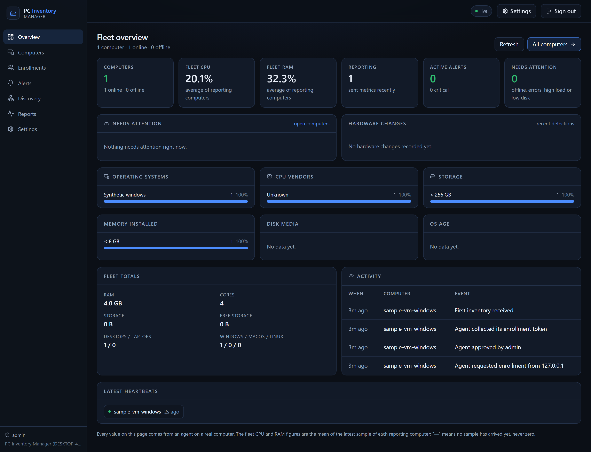
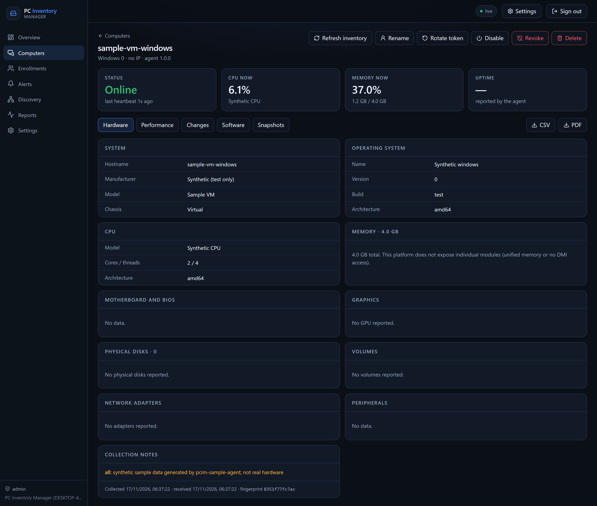
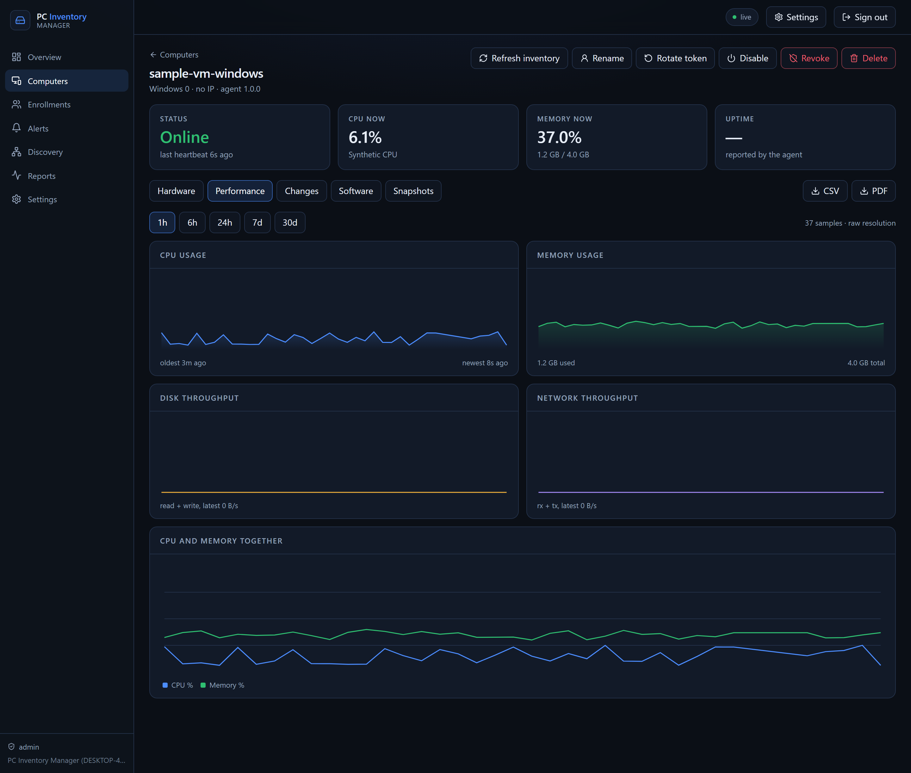
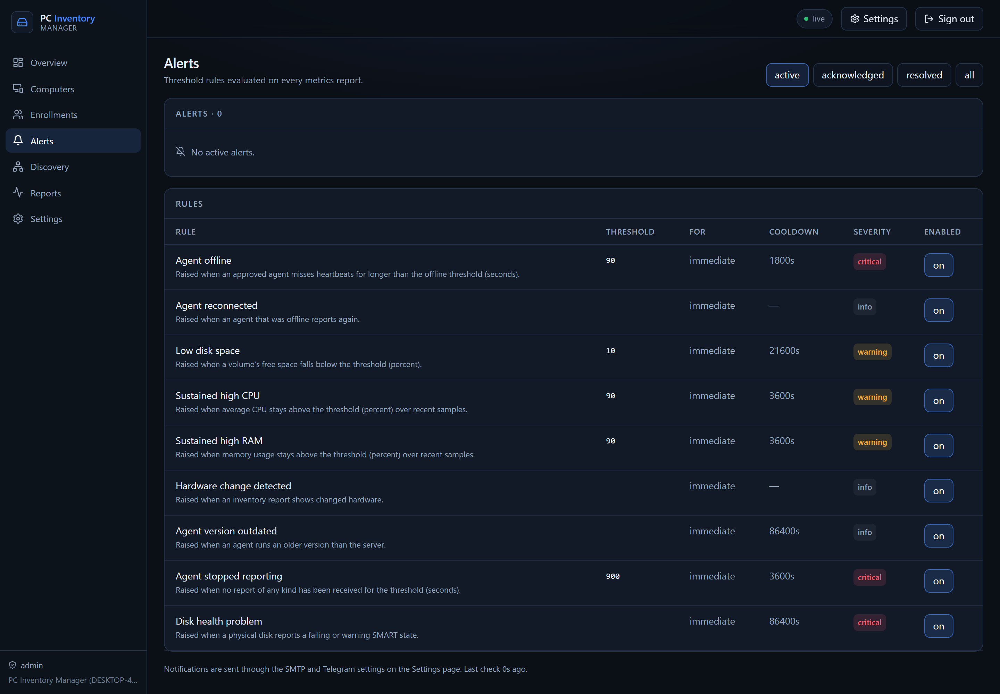
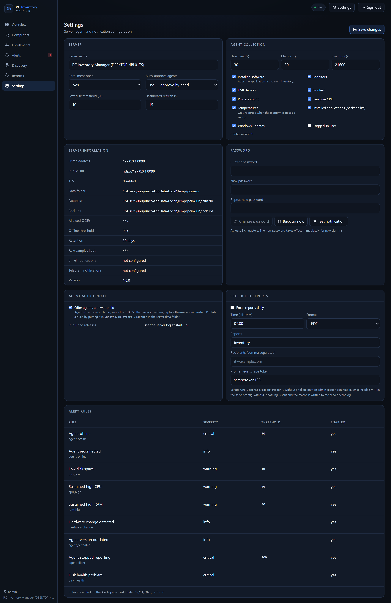
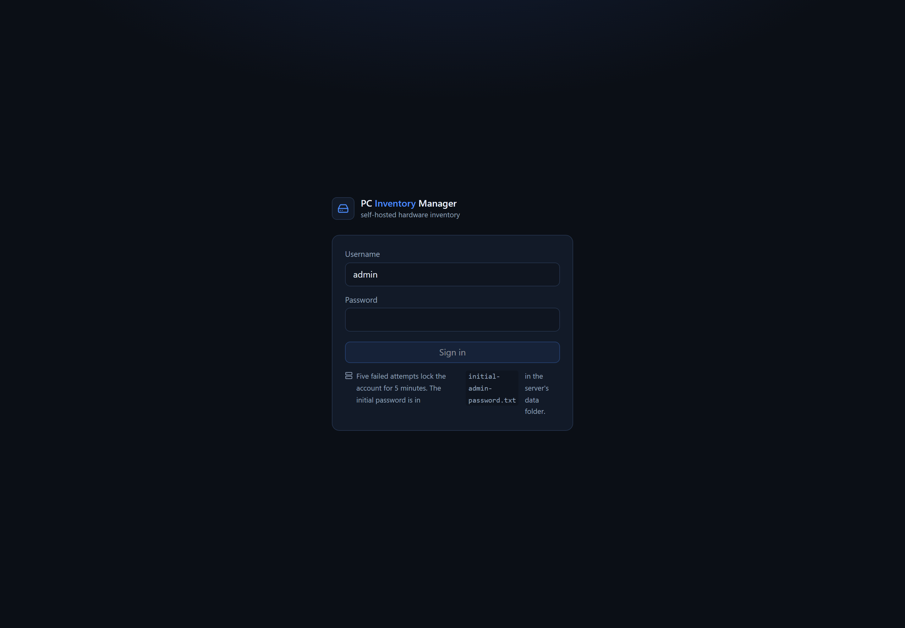

# PC Inventory Manager

Self-hosted IT inventory and monitoring for a home or small-office LAN.

- **Server** (Go, single binary): REST API, SQLite storage, embedded web dashboard, SSE live updates, hardware-change detection, performance history, alerts, reports (CSV/PDF), backups.
- **Agent** (Go, single binary): Windows, macOS and Linux. Collects real hardware, OS, network and performance data from the host and reports it to the server over **outbound** HTTP(S) only.

> Status: Phase 1 is working end to end on Windows — server, agent enrollment/approval, heartbeats, metrics, inventory, change detection, dashboard, reports, Prometheus metrics, software diff, scheduled report emails and agent auto-update. The macOS and Linux collectors are implemented but have not yet been run on real hardware.

## Screenshots

The dashboard is a React + TypeScript + Tailwind app built into the server binary.



*Fleet overview: computers, fleet CPU/RAM, alerts and hardware changes, OS/CPU/storage distributions, all live over SSE.*

| | |
|---|---|
|  |  |
| Selected computer — hardware, OS, CPU, memory modules, disks, volumes, adapters and any collection notes | CPU, memory, disk and network charts over 1 h / 6 h / 24 h / 7 d / 30 d, plus a software diff between inventories |

| | |
|---|---|
|  |  |
| Alerts with acknowledge/resolve and per-rule thresholds | Settings: server, agent collection, auto-update, scheduled reports, Prometheus token |



*These screenshots come from a development server fed by the bundled `test/sample-agent`, which sends clearly labelled synthetic data (`sample-vm-windows`, model "Synthetic (test only) Sample VM"). A real deployment shows the same screens with data from real machines — nothing on the dashboard is hard-coded.*

## What's new in 1.1.0

- **New dashboard**: rewritten in React + TypeScript with Tailwind, still compiled into the server binary — fleet overview, computers, computer detail with hardware/performance/changes/software/snapshots tabs, enrollments, alerts, discovery, reports and settings.
- **Prometheus `/metrics`**: every agent and fleet value in the Prometheus text format, protected by a scrape token (see [API_DOCUMENTATION](docs/API_DOCUMENTATION.md#prometheus-metrics)).
- **Software diff**: what was added, removed or version-changed between two inventories of the same computer.
- **Scheduled report emails**: daily PDF/CSV inventory, network, storage, distribution or change reports by SMTP.
- **Agent auto-update**: agents check every 6 hours, verify a SHA256 and restart into the new build; off by default until you publish a build.
- **GitHub Actions release pipeline**: `.github/workflows/release.yml` builds Windows, Linux, .deb, .rpm and macOS artifacts and attaches them to a tagged release.

## Download

Prebuilt packages are attached to the [latest release](https://github.com/unupunct/PC-Inventory/releases/latest):

| File | Platform |
|---|---|
| `pcim-1.1.0-windows-setup.exe` | Windows 10/11, Server 2016+ (x64) — installer that registers both services |
| `pcim-1.1.0-windows.zip` | Windows x64 portable |
| `pcim_1.1.0_amd64.deb` / `pcim-1.1.0-1.x86_64.rpm` | Debian/Ubuntu and Fedora/RHEL/Rocky (systemd) |
| `pcim-1.0.0-linux-amd64.tar.gz` / `-arm64.tar.gz` | Any Linux, with systemd units and `install.sh` |
| `pcim-agent-macos-arm64`, `pcim-agent-macos-amd64` | macOS 12+ agents |

Build everything yourself with `scripts/build.sh` (Windows installer: `scripts/build-windows.ps1`); see [docs/PACKAGING.md](docs/PACKAGING.md).

## Quick start (Windows)

```powershell
# 1. Start the server (it creates data\pcim.db and an initial admin password)
.\bin\pcim-server.exe
#    Dashboard: http://127.0.0.1:8080
#    Initial admin password: data\initial-admin-password.txt

# 2. On the machine to monitor, enroll the agent
.\bin\pcim-agent.exe enroll --server 192.168.1.100:8080

# 3. Approve it in the dashboard (Enrollments), then run it
.\bin\pcim-agent.exe run
```

The first `enroll` prints `waiting for administrator approval`. Approve the computer in the dashboard, then run `enroll` again (or just `run` — the agent keeps polling until it is approved and then collects its token). `run` sends inventory at start-up, metrics and heartbeats every 30 s, and buffers reports on disk whenever the server is unreachable.

## Building from source

Requires Go 1.24+ and Node 20+ (Node only for rebuilding the dashboard).

```bash
go build -o bin/pcim-server.exe ./cmd/server
go build -o bin/pcim-agent.exe  ./cmd/agent
```

Cross-compiling the agent:

```bash
GOOS=darwin GOARCH=arm64 go build -o bin/pcim-agent-macos-arm64 ./cmd/agent
GOOS=darwin GOARCH=amd64 go build -o bin/pcim-agent-macos-amd64 ./cmd/agent
GOOS=linux  GOARCH=amd64 go build -o bin/pcim-agent-linux-amd64 ./cmd/agent
```

The dashboard is a self-contained HTML file embedded in the server (`internal/server/webui/dist/index.html`); no Node build step is needed for the current version.

## Configuration

Server — environment variables (all optional):

| Variable | Default | Meaning |
|---|---|---|
| `PCIM_LISTEN_HOST` | `127.0.0.1` | Bind address. Use `0.0.0.0` to accept LAN agents. |
| `PCIM_PORT` | `8080` | Listen port |
| `PCIM_DATA_DIR` | `./data` | Data directory |
| `PCIM_DB_PATH` | `<data>/pcim.db` | SQLite database |
| `PCIM_ADMIN_PASSWORD` | generated | Initial admin password |
| `PCIM_OFFLINE_THRESHOLD_SEC` | `90` | Mark an agent offline after this long without a heartbeat |
| `PCIM_RETENTION_DAYS` | `30` | Performance history retention |
| `PCIM_TLS_CERT` / `PCIM_TLS_KEY` | – | Serve HTTPS |
| `PCIM_TLS_SELF_SIGNED` | `false` | Generate a self-signed certificate |

Agent — `agent.json` (default `C:\ProgramData\PCInventoryManager\Agent\agent.json` on Windows, `/etc/pcim-agent/agent.json` on Linux, `/usr/local/etc/pcim-agent/agent.json` on macOS):

| Key | Default | Meaning |
|---|---|---|
| `serverUrl` | – | Server base URL |
| `heartbeatSec` | 30 | Heartbeat interval |
| `metricsSec` | 30 | Performance sample interval |
| `inventorySec` | 21600 | Full inventory interval (6 h) |
| `collect*` | true | Toggles for software, monitors, USB, printers, processes, temperatures |

Intervals are server-controlled: values set in the dashboard override the local file on the next heartbeat.

## Agent commands

```
pcim-agent run       [--config PATH] [--log-level debug]
pcim-agent enroll    --server ADDR [--name NAME] [--insecure]
pcim-agent status    [--config PATH]
pcim-agent inventory [--json]
pcim-agent config    --server ADDR | --heartbeat N | --metrics N | --inventory N | --show
pcim-agent service   install|uninstall|start|stop|restart|status
pcim-agent version
```

`service install` registers the Windows service (`pcim-agent`), a systemd unit on Linux or a launchd daemon on macOS, with automatic restart.

## Security model

- Agents are approved by an administrator before they can report. Each agent gets its own random token; tokens can be rotated or revoked per agent, and every action is audited.
- Only outbound connections from agents; the server never connects to a computer.
- The server binds to loopback by default — it is not reachable from the network until you set `PCIM_LISTEN_HOST`.
- The agent never collects passwords, browser history, personal files or Wi-Fi credentials.
- Remote actions are restricted to: inventory refresh, token rotation, configuration update.

## Documentation

- [INSTALLATION](docs/INSTALLATION.md) — server and agent install on each OS
- [SERVER_SETUP](docs/SERVER_SETUP.md) — configuration, TLS, backups, retention
- [WINDOWS_AGENT](docs/WINDOWS_AGENT.md) · [MACOS_AGENT](docs/MACOS_AGENT.md) · [LINUX_AGENT](docs/LINUX_AGENT.md)
- [CONFIGURATION](docs/CONFIGURATION.md) — every setting
- [API_DOCUMENTATION](docs/API_DOCUMENTATION.md) — REST endpoints
- [SECURITY](docs/SECURITY.md) — threat model and hardening
- [TROUBLESHOOTING](docs/TROUBLESHOOTING.md)
- [DEVELOPMENT](docs/DEVELOPMENT.md)

## What the agent reports

Hardware: CPU (model, cores, frequencies), memory modules (size, type, speed, slot), GPUs, motherboard/BIOS, physical disks (model, serial, capacity, media type, health, SMART temperature), volumes, monitors, batteries (design/full capacity, cycles, health), audio, USB, Bluetooth, printers, optical drives.
Software: installed applications, Windows updates/hotfixes, Defender status.
System: OS build, install date, uptime, timezone, activation, network adapters (IP, MAC, gateway, DNS, link speed), logged-in user.

Anything a platform cannot provide is reported as *unsupported* rather than as zero.
